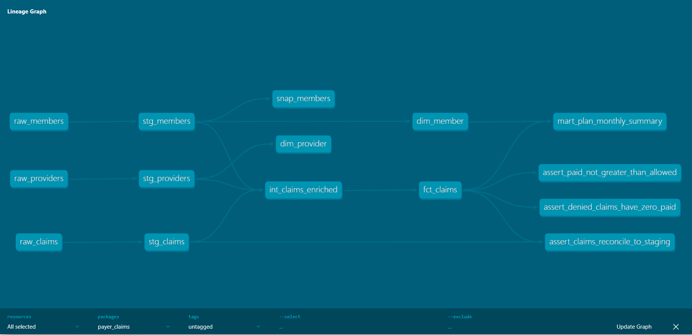
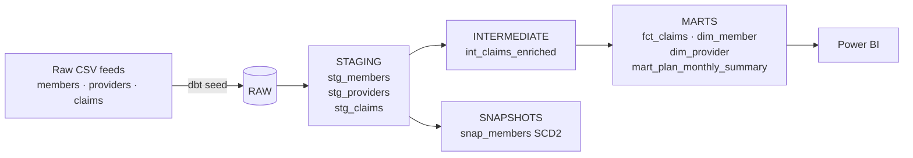
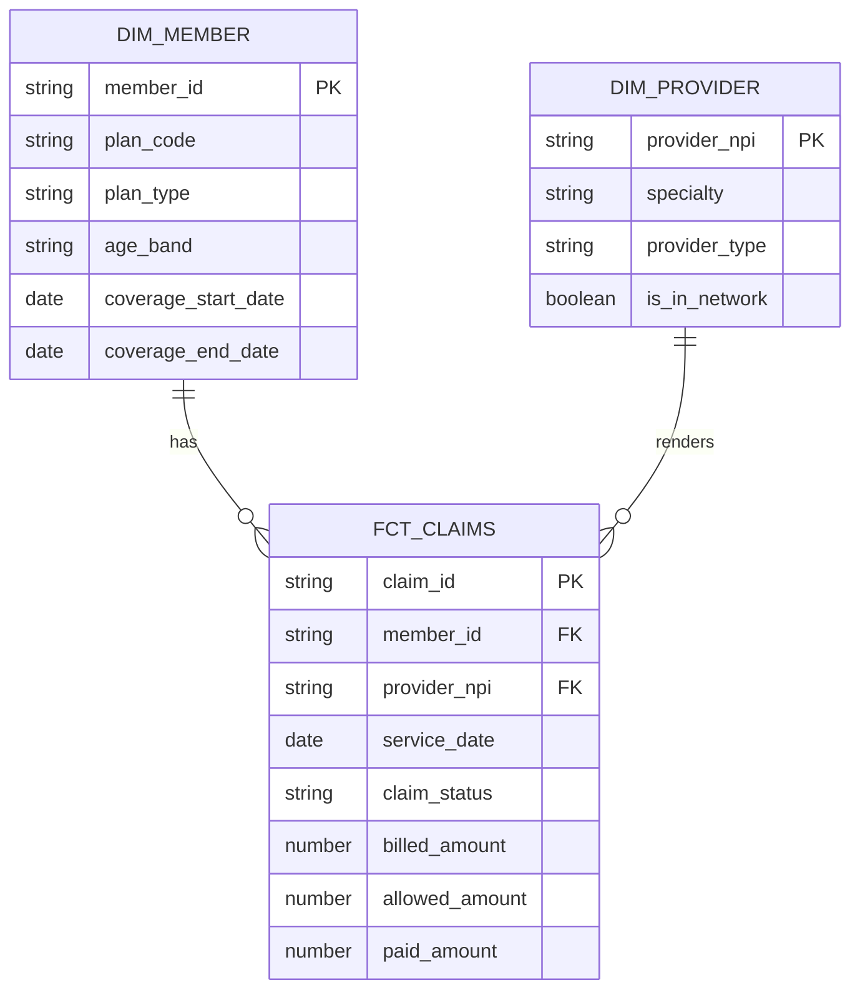
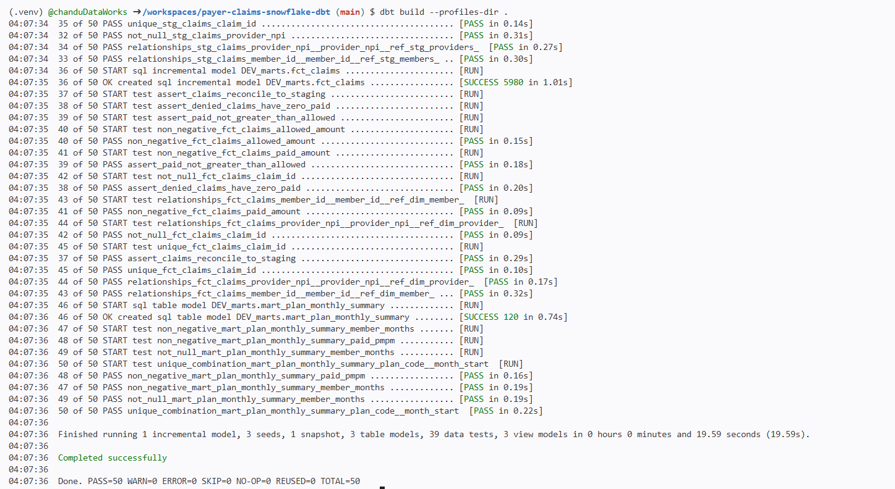
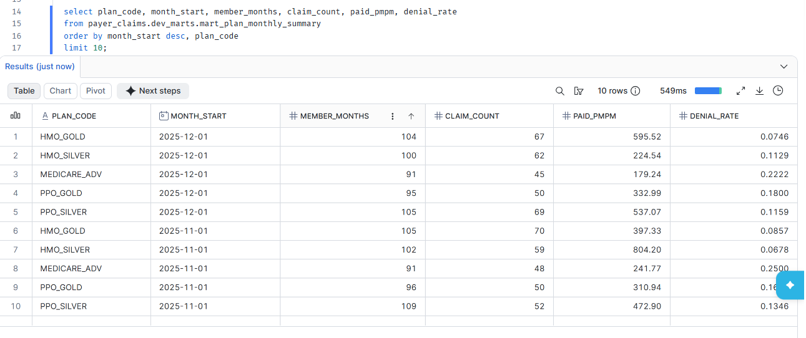

# Healthcare Payer Claims Warehouse — Snowflake + dbt

An end-to-end analytics engineering project. It turns raw health plan claims, member and provider feeds into a tested star schema on Snowflake, with a Power BI layer on top.

All data is **synthetic**, generated by a script. No real PHI is used.


<!-- add your screenshots to /images after running the project -->

---

## What this project demonstrates

| Area | What's implemented |
| --- | --- |
| **Data modeling** | Staging → intermediate → marts layering; star schema (`fct_claims`, `dim_member`, `dim_provider`) |
| **Data quality** | 39 tests: unique, not_null, relationships, accepted_values, custom generic tests (`non_negative`, `unique_combination`), and singular business-rule tests |
| **Incremental loading** | `fct_claims` merges on `claim_id` with a 3-day lookback window for late corrections |
| **Data cleaning** | De-duplicates resubmitted claims (latest `loaded_at` wins) and standardises dirty status values |
| **SCD Type 2** | `snap_members` snapshot tracks plan, county and coverage changes over time |
| **Healthcare KPIs** | Member months, paid PMPM, claims per 1,000 (annualised), denial rate, days-to-pay |
| **Snowflake admin** | Warehouse sizing, auto-suspend, resource monitor, RBAC with `TRANSFORMER` / `REPORTER` roles |
| **Reconciliation** | Test that row counts and paid totals match between staging and the fact table |
| **BI** | Power BI star-schema model and DAX measures (YoY, PMPM, denial rate) |

---

## Architecture



| Layer | Materialization | Purpose |
| --- | --- | --- |
| staging | view | Rename, cast, trim, de-duplicate. One model per source. |
| intermediate | ephemeral | Joins and business flags, reused by marts |
| marts | table / incremental | Reporting-ready facts, dimensions and KPI summaries |
| snapshots | snapshot | Member history (SCD Type 2) |

---

## Data model



---

## Project structure

```
payer-claims-snowflake-dbt/
├── models/
│   ├── staging/          stg_members, stg_providers, stg_claims + tests
│   ├── intermediate/     int_claims_enriched
│   └── marts/            fct_claims, dim_member, dim_provider, mart_plan_monthly_summary
├── snapshots/            snap_members (SCD2)
├── tests/                singular business-rule and reconciliation tests
├── macros/               generate_schema_name, custom generic tests
├── seeds/                synthetic raw data (CSV)
├── scripts/              generate_data.py
├── setup/                snowflake_setup.sql
├── powerbi/              model + DAX measures
└── profiles.example.yml
```

---

## How to run

### Option A: Snowflake (free trial)

```bash
# 1. In Snowsight, run setup/snowflake_setup.sql as ACCOUNTADMIN

# 2. Install dbt
python -m venv .venv && source .venv/bin/activate      # Windows: .venv\Scripts\activate
pip install dbt-snowflake

# 3. Key-pair auth (keys live outside the repo, never commit them)
openssl genrsa 2048 | openssl pkcs8 -topk8 -inform PEM -out ~/.ssh/snowflake_rsa_key.p8 -nocrypt
openssl rsa -in ~/.ssh/snowflake_rsa_key.p8 -pubout -out ~/.ssh/snowflake_rsa_key.pub
#    then in Snowsight:  ALTER USER <you> SET RSA_PUBLIC_KEY='<key body without BEGIN/END lines>';

# 4. Profile + environment variables
cp profiles.example.yml profiles.yml
export SNOWFLAKE_ACCOUNT=orgname-accountname SNOWFLAKE_USER=xxxx
export SNOWFLAKE_PRIVATE_KEY_PATH=~/.ssh/snowflake_rsa_key.p8
dbt debug --profiles-dir .                              # should end with "All checks passed!"

# 5. Build everything: seeds, models, snapshot, tests
dbt build --profiles-dir .

# 6. Browse docs and the lineage graph
dbt docs generate --profiles-dir . && dbt docs serve --profiles-dir .
```

### Option B: local, no cloud account (DuckDB)

```bash
pip install dbt-duckdb
cp profiles.example.yml profiles.yml
dbt build --target local --profiles-dir .
```

### Regenerate the data

```bash
python scripts/generate_data.py
```

---

## Key design decisions

- **Resubmitted claims:** payers often receive the same claim again after a correction. `stg_claims` keeps only the latest version per `claim_id` using `row_number()` over `loaded_at`.
- **Incremental with lookback:** `fct_claims` reprocesses the last 3 days of loads on every run. Late-arriving corrections still land, and MERGE on `claim_id` prevents duplicates.
- **Member months:** a member counts in a month if their coverage overlaps any day of it. This is the standard denominator for PMPM.
- **Schema naming:** the `generate_schema_name` macro writes to `DEV_STAGING`, `DEV_MARTS` in dev and to `STAGING`, `MARTS` in prod, so developers never overwrite production.
- **Cost control:** an XSMALL warehouse with 60-second auto-suspend and a 5-credit monthly resource monitor.

---

## Results

Run `dbt build` to get 50 nodes (3 seeds, 7 models, 1 snapshot, 39 tests), all passing.

Sample output from `mart_plan_monthly_summary`:

| plan_code | month_start | member_months | claim_count | paid_pmpm | denial_rate |
| --- | --- | --- | --- | --- | --- |
| HMO_GOLD | 2025-12-01 | 104 | 67 | 595.52 | 0.0746 |
| MEDICARE_ADV | 2025-12-01 | 91 | 45 | 179.24 | 0.2222 |
| PPO_SILVER | 2025-12-01 | 105 | 69 | 537.07 | 0.1159 |





---

## Tech stack

Snowflake · dbt Core · SQL · Python · Power BI · Git
